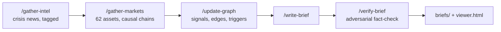

# Hive Mind

A knowledge graph and daily brief that track the 2026 West Asia crisis (the US–Israel war on Iran) and how it spreads into oil, gas, shipping, rates, currencies and equity markets. Built with Claude Code.

**[Open the live knowledge graph](https://nimitmehra.com/hive-mind/viewer.html)**

## What this is

Hive Mind is an intelligence pipeline, not a news feed. Each run gathers the day's crisis developments and market moves, records them in a persistent graph of countries, institutions, commodities, trade routes, indices and people, and writes a brief from what changed. A separate fact-checker then audits the brief.

The brief tries to answer, in order: what happened in the war, what happened in markets, why each market moved, whether the move was crisis-driven or not, which connections strengthened or appeared, and which trigger points are getting close.

It was the first system of its kind that [Nimit Mehra](https://github.com/nimitmehra) built. The US equity pipeline he built later reuses its graph design, provenance tags and writer/verifier split. The code and skills were written by Claude Code to his specifications. The same pattern now runs on US equities, Indian equities, global macro and crypto.

## Pipeline



The orchestrator skill `/crisis-brief` runs the five steps in order and checks the output after each one.

| Step | Skill | Job |
|---|---|---|
| 1 | `/gather-intel` | Collect and verify the day's developments. Tag every finding. Check both sides. Keep rhetoric apart from action. |
| 2 | `/gather-markets` | Pull 62 assets via `scripts/market-data.py` (energy, metals, agriculture, indices, sector ETFs, bellwether stocks, bonds, volatility, currencies) and explain each significant move. |
| 3 | `/update-graph` | Add signals to nodes, re-weight edges, and move trigger points only on confirmed action. |
| 4 | `/write-brief` | Compose the brief. The source tag of each item decides how it is worded. |
| 5 | `/verify-brief` | Challenge every claim, record corrections, and check that no item's tag was quietly upgraded. |

Each skill is written as a full job description with a persona, a way of thinking, and examples of good and bad work. `OPERATIONS.md` is the team handbook.

## Key design ideas

**Provenance tags.** Every finding is CONFIRMED (two or more independent sources, both sides checked), REPORTED (one credible source) or CLAIMED (one side's assertion). Rhetoric is tracked separately from action. The graph step gives CONFIRMED items full weight and CLAIMED items none. The writer states CONFIRMED items as fact, writes REPORTED items as reports, and always attributes CLAIMED items to the party making them.

**Trigger points move on action, not words.** A trigger becomes `active` only on a confirmed action seen by two or more independent operational sources, such as maritime trackers, insurers, military channels or published data. Threats and preparations leave it at `watching`.

**Researcher and fact-checker are separate.** The pipeline began as one skill. On 24 March 2026 that skill turned a single outlet's "Houthi join the fight" headline into a fact, when no Houthi attack had been confirmed in 25 days. Research and verification were the same pass, so verification was skipped. Splitting them into separate steps with separate prompts is the fix. (The Houthis did enter the war four days later, and the system then tagged it CONFIRMED on IDF, Houthi and independent reporting.)

**Edge weights decay fast.** `weight = min(10, frequency × recency × directness)`. Recency falls from 1.0 today to about 0.3 after 30 days, because crisis information goes stale quickly.

**Bounded node files.** Each node keeps a current summary, active triggers, top edges, recent signals and rolled-up historical summaries. Git history is the full audit trail, which keeps every node small enough to read in one pass. `graph/edges.json` is the master edge index.

**Media literacy.** `OPERATIONS.md` contains a source guide covering more than 50 outlets across Iran, Israel, the US, India, the Gulf and Europe. The core rule: editorials from independent media are not intelligence, while editorials from state-controlled media do show a government's position.

## Numbers

As of 2026-09-26 (last run 2026-09-22):

| | |
|---|---|
| Nodes | 63: 19 countries, 12 institutions, 7 commodities, 7 sectors, 6 indices, 5 persons, 4 companies, 3 trade routes |
| Weighted edges | 406 (in `graph/edges.json`) |
| Active trigger points | 260 across all nodes |
| Brief files | 103 (morning, evening and special editions) on 88 dates, 2026-03-23 to 2026-09-22 |
| Verification reports | 62 |
| Market assets tracked | 62 |
| Commits | 158 |

## Repository layout

```
hive-mind/
├── .claude/commands/     The six pipeline skills Claude Code runs
├── skills/               Readable copies of the same skills
├── briefs/               Briefs and their verification reports
├── graph/
│   ├── nodes/*.json      One file per node: summary, triggers, top edges, signals
│   ├── edges.json        Master edge index
│   └── meta.json         Graph statistics
├── scripts/
│   ├── market-data.py    62-asset market pull via yfinance
│   ├── rebuild-viewer.py Regenerates viewer.html from the graph
│   └── update_graph_*.py Dated one-off graph update scripts
├── research/             Backfill research for 28 Feb – 23 Mar 2026
├── viewer.html           Self-contained interactive graph (Cytoscape.js)
├── ARCHITECTURE.md       Schemas, weighting and verification rules
├── ARCHITECTURE_NODE_TIERING.md   Decision record for bounded node files
└── OPERATIONS.md         Team handbook: roles, personas, examples, media guide
```

## How to run

Requires [Claude Code](https://docs.anthropic.com/en/docs/claude-code) and Python 3 with `yfinance`.

```bash
pip install yfinance
python3 scripts/market-data.py           # full report with alerts
python3 scripts/market-data.py --alerts  # significant moves only
python3 scripts/market-data.py --json    # structured output for the graph step
```

In Claude Code, from the repository root:

```
/crisis-brief        # full pipeline
/gather-intel        # or one step at a time
/gather-markets
/update-graph
/write-brief
/verify-brief
python3 scripts/rebuild-viewer.py        # refresh viewer.html
```

Open `viewer.html` in a browser. It needs no server.

## Status and limitations

- **Runs are manual and irregular.** Scheduled runs were turned off in June 2026. Since then a run happens when one is started by hand, so there are gaps of days or weeks between briefs.
- **Edge weights are judgments.** Directness and edge creation are decided by the model under written rules. They are not estimated statistically from price data.
- **Sources are web search and yfinance.** Futures prices jump on contract-roll days, and the briefs note this when it affects a figure. Single-source reports are labelled, not dropped.
- **Written by AI agents.** Briefs are model-written and model-checked. Each verification report lists the corrections it made. That shows errors being caught, not that none remain.
- **Not investment advice.** The briefs discuss markets and positioning in general terms for research purposes.

## License

MIT. See [LICENSE](LICENSE).
